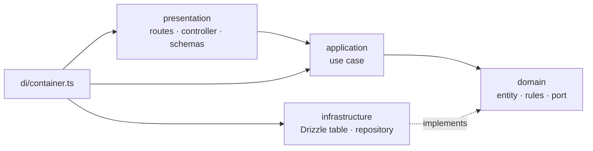

# Arsitektur Express Personal Finance

Dokumen ini adalah kontrak arsitektur backend. Setiap aturan di bawah dijaga otomatis oleh tool, jadi pelanggaran langsung gagal di editor, saat `git push`, atau di CI. Kalau sebuah aturan terasa menghalangi, ubah dokumen ini dan pengamannya dalam satu commit yang sama, jangan cuma melewatinya. Penjelasan desain yang lebih panjang (alur request, keputusan teknis) ada di [`PRD.md`](PRD.md) bagian 6.

## Lapisan per modul

Setiap fitur adalah satu modul di `src/modules/<fitur>/` dengan empat layer. Arah dependency hanya boleh ke dalam.

| Layer | Isi | Boleh import | Dilarang import |
|---|---|---|---|
| `domain/` | Entity, aturan bisnis, interface repository (port) | `shared/domain` | Layer lain, `config`, `di`, `express`, `zod`, `pino` |
| `application/` | Use case | domain | infrastructure, presentation, `config`, `di`, `express` |
| `infrastructure/` | Tabel Drizzle (`*.table.ts`), repository Postgres dan in-memory | domain, `shared/database` | presentation, `di`, `express` |
| `presentation/` | `*.routes.ts`, `*.controller.ts`, `*.schemas.ts` | application, domain, `shared/http` | infrastructure, `config` |

Layer tidak boleh punya subfolder, dan file di `presentation/` wajib memakai salah satu dari tiga akhiran di atas.

## Aturan lintas modul

- `src/di/container.ts` adalah satu-satunya tempat yang merakit object konkret (repository, use case, controller). Infrastructure hanya boleh di-import oleh modulnya sendiri, `di/container.ts`, `scripts/`, dan file test.
- Dependency antar modul tidak boleh melingkar. Kalau modul `summary` memakai `transaction`, maka `transaction` tidak boleh balik memakai `summary`.
- `src/shared/` bersifat generik dan tidak boleh import `modules/`, `di/`, `config/`, `app.ts`, atau `main.ts`.

## Batas pemakaian library

- `express` hanya dipakai di `presentation/`, `shared/http/`, `app.ts`, dan `main.ts`.
- `drizzle-orm` dan `pg` hanya dipakai di `infrastructure/`, `shared/database/`, dan `scripts/`.

## Aturan runtime dan HTTP

- Hanya `src/config/env.ts` yang membaca `process.env`. Env divalidasi dengan zod saat server start.
- Node menjalankan file `.ts` langsung (type stripping), jadi import relatif wajib memakai ekstensi `.ts`, dan `enum`, `namespace`, serta parameter property di constructor dilarang (dicek `erasableSyntaxOnly` di `tsconfig.json`).
- Controller tidak memakai try/catch. Express 5 meneruskan error async ke `errorHandler`.
- Response sukses berbentuk `{ data }`, response gagal berbentuk `{ error: { code, message, details? } }`, dan field JSON memakai `snake_case`. Kontrak lengkapnya ada di `PRD.md` bagian 5 dan harus tetap cocok dengan frontend.

## Migration database

- Schema tabel hanya ditulis di `modules/<fitur>/infrastructure/*.table.ts`.
- Setiap perubahan `*.table.ts` wajib disertai file migration hasil `npm run db:generate` di commit yang sama. `npm run db:check` gagal kalau schema dan isi folder `drizzle/` tidak cocok.

## Siapa yang menjaga aturan ini

| Pengaman | Lokasi | Yang dicek | Kapan jalan |
|---|---|---|---|
| ESLint | `eslint.config.js` | Arah import per layer, `process.env` hanya di `env.ts` | Di editor dan `npm run lint` |
| TypeScript | `tsconfig.json` | Syntax yang bisa dijalankan Node langsung (`erasableSyntaxOnly`) | `npm run typecheck` |
| Architecture test | `src/architecture.test.ts` | Struktur folder, nama file presentation, batas antar modul, siklus, batas library, ekstensi `.ts`, try/catch di controller | `npm test` |
| Pre-push hook | `.githooks/pre-push` | Typecheck, lint, test | Setiap `git push` |
| CI | `.github/workflows/ci.yml` | Semua di atas, build, kecocokan migration, dan test repository ke Postgres sungguhan | Setiap push ke `main` dan setiap PR |

Pre-push hook aktif otomatis setelah `npm install` lewat script `prepare`, yang menjalankan `git config core.hooksPath .githooks` khusus untuk repo ini.

## Menambah fitur baru

Contoh berikut memakai fitur ringkasan bulanan (`summary`) dari PRD bagian 4, Epic B.

1. Buat `src/modules/summary/domain/` berisi tipe `MonthlySummary` dan aturan hitungnya.
2. Buat use case `GetMonthlySummary` di `application/`, beserta unit test dengan repository in-memory.
3. Kalau butuh tabel baru, tulis `infrastructure/<nama>.table.ts`, jalankan `npm run db:generate`, lalu buat repository Postgres-nya.
4. Buat `summary.schemas.ts`, `summary.controller.ts`, dan `summary.routes.ts` di `presentation/`, beserta test HTTP dengan supertest.
5. Rakit dependency di `src/di/container.ts`, lalu pasang router di `src/app.ts`.
6. Jalankan `npm run verify` sebelum commit.
